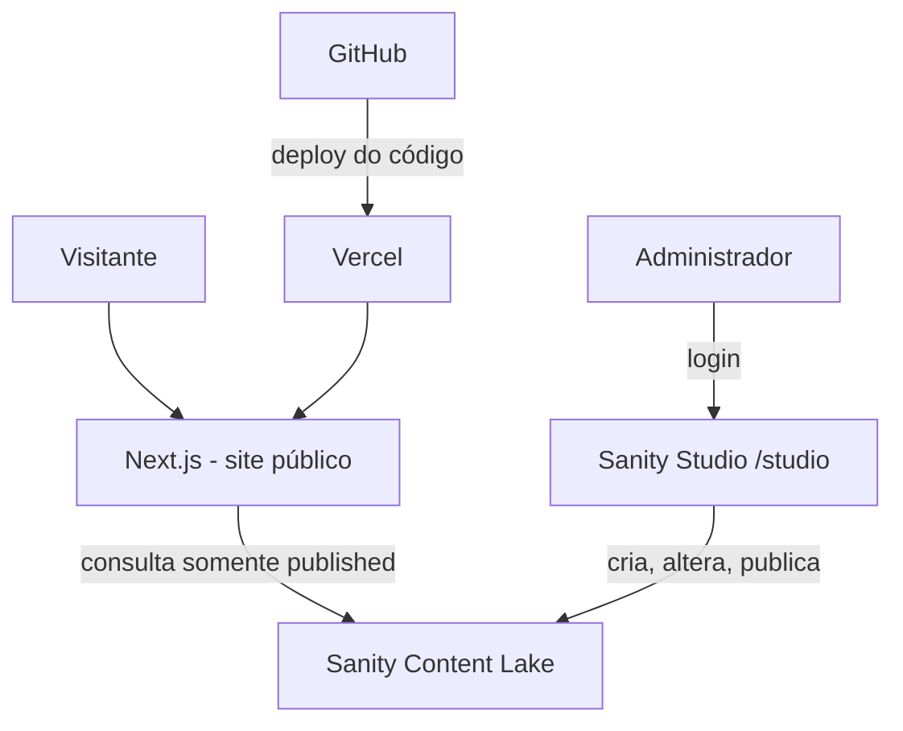

# Architecture — Visão técnica do MVP

**Estado:** proposta aprovada para construção inicial; detalhes de versão/integração dependem de validação durante bootstrap.

## 1. Stack e motivações

| Camada | Tecnologia | Por quê |
|---|---|---|
| UI e páginas | Next.js App Router + React + TypeScript | Roteamento, SEO, renderização híbrida e deploy integrado |
| CSS | Tailwind CSS + variáveis CSS | Design consistente, sem criar um framework próprio |
| CMS/editor | Sanity Studio | CRUD, login editorial, rich text e upload de imagens prontos |
| Persistência | Sanity Content Lake | Sem banco SQL/infra própria para ~100 projetos |
| Conteúdo | GROQ via `next-sanity` | Queries por tipo, slug, data e relações |
| Hospedagem | Vercel (plano a confirmar) | Deploy ligado a GitHub, HTTPS e configuração simples |
| Controle de versão | GitHub | Código e documentação; **não** posts como arquivos-fonte |
| Animação | CSS/transitions; biblioteca leve só se justificada | Evitar bundle e complexidade desnecessária |

Não existem APIs de escrita próprias no MVP: as escritas são realizadas no Studio autenticado usando as permissões do Sanity.

## 2. Fluxo de dados



**Invariante:** publicar conteúdo pelo CMS não faz commit Git nem exige redeploy. Alterações vêm do Content Lake no runtime, sujeitas à estratégia de cache.

## 3. Organização sugerida de código (alvo; ainda não criado)

```text
src/
  app/
    (site)/
      page.tsx                    # Home
      projetos/page.tsx
      projetos/[slug]/page.tsx
      artigos/page.tsx
      artigos/[slug]/page.tsx
      sobre/page.tsx
      layout.tsx
    studio/[[...tool]]/page.tsx   # Studio embutido, se adotado
    not-found.tsx
    sitemap.ts
    robots.ts
    layout.tsx
  components/
    layout/
    projects/
    articles/
    ui/
  sanity/
    schemaTypes/
    lib/
      client.ts
      queries.ts
      image.ts
  styles/
    tokens.css
public/
  images/                    # Somente assets próprios e licenciados
```

A estrutura deve ser ajustada à documentação oficial vigente. Nomes de arquivos são direcionais, não obrigação se conflitarem com versões atuais da biblioteca.

## 4. Estratégia de dados e cache

1. **Público:** consultar conteúdo do Sanity sob `perspective: 'published'`. Nenhuma informação de rascunho deve ser obtida por visitantes.
2. **Rascunho:** gerenciado/visualizado no Studio. Preview de rascunhos dentro do site público não é necessário para a primeira entrega; se adicionado, usar Draft Mode seguro e token **somente no servidor**.
3. **Atualização após publicação:** definir um mecanismo explícito para manter o conteúdo atualizado sem deploy. Adotar, após conferir documentação das versões instaladas, cache com revalidação curta (por exemplo, até 60 s), publicação com invalidação dirigida ou mecanismos oficiais de live content. **Meta mensurável: alterações visíveis publicamente em até 120 s em condições normais.** Não confundir TTL configurado com promessa garantida sem teste.
4. **Slugs novos:** uma URL nova precisa funcionar no runtime, sem rebuild. Não limitar páginas a caminhos enumerados no build.
5. **Despublicação:** invalidar conteúdo da página e da listagem; slug deve retornar `notFound()`/404 conforme contrato.
6. **SEO e metadados:** devem consultar a mesma fonte publicada, não valores antigos hardcoded.
7. **Paginação:** em `/projetos`, idealmente 9 ou 12 por página, com estratégia estável e desempenho adequado até 100 itens. Artigos também podem paginar quando necessário.
8. **Falhas:** tratar estado vazio e indisponibilidade transitória sem vazar erros internos.

## 5. Segurança e permissões

- O Studio em `/studio` pode disponibilizar sua página de entrada publicamente, mas **operações de edição exigem autenticação e permissão do Sanity**. Não confundir rota acessível com dados editáveis.
- `NEXT_PUBLIC_SANITY_PROJECT_ID` e `NEXT_PUBLIC_SANITY_DATASET` podem ser públicos; **tokens não**.
- Nunca adicionar `SANITY_API_WRITE_TOKEN` ao cliente, bundles, logs ou repositório.
- Não embutir dados corporativos/confidenciais nos documentos de exemplo e publicações.
- Se existir preview de drafts, usar a implementação oficial de validação de segredo e ativação de sessão; não usar query parameter desprotegido.
- Validar formatos de links externos e renderização rich text; não permitir HTML arbitrário inserido no CMS sem sanitização.
- No Sanity: habilitar somente as origens CORS necessárias; gerenciar membros com acesso mínimo.
- `.env.local` no `.gitignore`, `.env.example` sem valores sensíveis.

## 6. Modelos e integração

- Tipos editoriais detalhados em `CONTENT_MODEL.md`.
- Reutilizar um único client Sanity parametrizado conforme o modo da consulta.
- Projeções de GROQ específicas para cards/detalhes. Não buscar corpo inteiro de todos os artigos na listagem.
- Rich text de artigo: **Portable Text** com renderizadores sem HTML arbitrário. Suportar headings, listas, links, imagens, blocos de código com linguagem e legendas quando pertinente.
- Assets de imagem gerenciados por Sanity; usar dimensões responsivas, formatos adequados e alternativas de texto.
- Implementar TypeScript sólido; geração de tipos por Sanity TypeGen é recomendada se compatível, mas não é requisito para exibir a primeira tela.

## 7. SEO e acessibilidade técnica

- Server-rendering/metadata do Next para títulos e descrições de páginas e artigos.
- `sitemap.ts` e `robots.ts`; URLs canônicas quando aplicável.
- Open Graph padrão e imagem dinâmica/fixa com assets próprios.
- `next/image` ou componente suportado integrado ao CDN do Sanity, respeitando otimização e licenças.
- Leitura em semântica correta: `main`, `article`, `nav`, `h1`, `time`, `pre`, `code`.
- `lang="pt-BR"`, skip link, foco visível e mobile-first.

## 8. Ambientes e entregas

| Ambiente | Objetivo | Dados |
|---|---|---|
| Local | Desenvolver e validar schema e UI | Dataset de desenvolvimento ou conteúdo de teste claramente identificado |
| Preview de deploy | Conferir mudanças de código | Nunca expor rascunhos ao público por engano |
| Produção | Portfólio público | Dataset publicado de produção |

Preferir **dois datasets** (`development`, `production`) se o plano/complexidade comportar; para projeto mínimo, um único dataset com documentos de teste removidos antes do lançamento é opção aceitável. Decidir e registrar antes de popular conteúdo.

## 9. Deploy e custo

- Aplicação versionada no GitHub; deploy de código via Vercel.
- Variáveis públicas e segredos configurados no ambiente correto.
- Domínio próprio opcional; SSL provido pela hospedagem.
- Monitorar consumo de API/assets e limites dos provedores.
- **Vercel Hobby restringe uso a projetos pessoais não comerciais**, conforme documentação atual; verificar enquadramento do uso pretendido (portfólio/captação profissional) e escolher plano/hospedagem compatível se necessário.
- Backups/export do Sanity: programar uma exportação manual periódica no início; automação em outra fase.

## 10. Testes

1. Build, TypeScript, lint.
2. Teste de leitura publicada e retorno 404 em slug inválido.
3. Testes de integração: criar → publicar → listar/detalhar → atualizar → despublicar → excluir, para ambos os tipos.
4. Inspeção visual 360/768/1440 px.
5. Acessibilidade: teclado, foco, contraste, redução de movimento.
6. SEO: sitemap e metadados de pelo menos um projeto e um artigo.
7. Capacidade: até 100 projetos publicados ou seed isolado, sem travar navegação.

## 11. Fontes oficiais para implementação

- Next.js App Router: https://nextjs.org/docs/app
- Next.js Metadata: https://nextjs.org/docs/app/getting-started/metadata-and-og-images
- Next.js produção: https://nextjs.org/docs/app/guides/production-checklist
- Sanity + Next: https://www.sanity.io/docs/nextjs
- Studio embutido: https://www.sanity.io/docs/nextjs/embedding-sanity-studio-in-nextjs
- Sanity perspectivas: https://www.sanity.io/docs/content-lake/perspectives
- Sanity autenticação: https://www.sanity.io/docs/content-lake/http-auth
- Vercel Hobby: https://vercel.com/docs/plans/hobby

**Nota:** os exemplos de APIs e versões de tutoriais podem mudar; o agente deve validar a documentação para as versões efetivamente instaladas.

